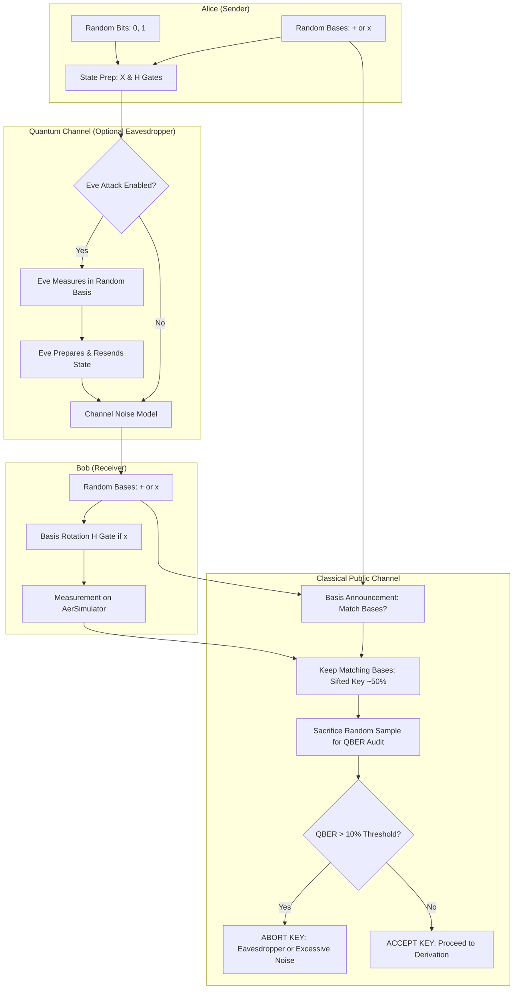

<div align="center">

# QShield | Quantum Key Distribution & Eavesdropping Detection

**VTU-QFF-HC-0104** &nbsp;|&nbsp; Tier: **Online** &nbsp;|&nbsp; Track 1: **Quantum Cryptography & Security**

</div>

---

<div align="center">

| | |
| :--- | :--- |
| **Project** | **QShield**: Quantum Key Distribution (BB84) & Eavesdropping Detection |
| **Team** | Qubit Titans |
| **Team ID** | VTU-QFF-HC-0104 |
| **Tier** | Online |
| **Repository** | [vtu-hc-qubit-titans](https://github.com/vtu-qiskit-fall-fest-2026/vtu-hc-qubit-titans.git) |
| **Organisation** | [vtu-qiskit-fall-fest-2026](https://github.com/vtu-qiskit-fall-fest-2026) |
| **Event** | VTU-QFF Hackathon — VTU-Qiskit Fall Fest 2026 |

</div>

---

## 📌 Table of Contents

- [Team Members](#-team-members-github-ids)
- [Problem Statement](#-problem-statement)
- [Proposed Solution](#-proposed-solution)
- [Approach & Architecture](#-approach--architecture)
- [Tech Stack](#-tech-stack)
- [Project Structure](#-project-structure)
- [How to Run](#-how-to-run)
- [How to Test](#-how-to-test)
- [Simulation Results & Verification](#-simulation-results--verification)
- [Limitations & Real-World QKD](#-limitations--real-world-qkd)
- [Submission Checklist](#-submission-checklist)
- [Resources & References](#-resources)
- [License](#-license)

---

## 👥 Team Members (GitHub IDs)

| # | Role in Hackathon | Responsibilities | Core Files Owned |
| :-- | :--- | :--- | :--- |
| 1 | **Quantum Core Lead** (Member 1) | Qiskit circuit construction, state preparation, measurement, and AerSimulator execution | `bb84.py`, `test_quantum.py` |
| 2 | **Security & Protocol Lead** (Member 2) | BB84 logic, Eve intercept-resend attack, basis sifting, QBER calculation, and unit tests | `security.py`, `tests/` |
| 3 | **Dashboard & Documentation Lead** (Member 3) | Streamlit dashboard, visual analytics, benchmark comparisons, slides, and README | `app.py`, `README.md`, `presentation/` |

---

## ❓ Problem Statement

**Problem:**  
Modern digital infrastructure relies upon public-key cryptosystems (such as RSA, Diffie-Hellman, and ECC) to establish shared secret keys over insecure communication channels. These cryptosystems depend on computational hardness assumptions (e.g., factoring large integers and computing discrete logarithms). With the emergence of fault-tolerant quantum computers running Shor's Algorithm, these mathematical foundations will be broken. Furthermore, adversaries are executing **"Harvest Now, Decrypt Later"** attacks, storing encrypted classical traffic today to decrypt once quantum hardware matures.

**Why it matters:**  
Symmetric ciphers such as AES-256 remain robust against quantum attacks (via Grover's Algorithm, which only halves effective key length). However, securely distributing symmetric keys across classical networks without interception remains an unsolved vulnerability in pure classical cryptography.

**Track / Category:**  
Online Tier · Track 1: Quantum Cryptography & Security

---

## 💡 Proposed Solution

**Solution:**  
**QShield** is an interactive Quantum Key Distribution (QKD) educational simulator built with **Qiskit** and **Streamlit**. It implements the four-state **Bennett-Brassard 1984 (BB84)** protocol, using genuine single-qubit quantum circuits executed on Qiskit's `AerSimulator`. QShield demonstrates how quantum principles—specifically the **No-Cloning Theorem** and wavefunction collapse—allow Alice and Bob to establish a shared symmetric key while detecting eavesdroppers (Eve) through Quantum Bit Error Rate (QBER) analysis.

**Key idea:**  
Eavesdropping on unknown quantum states unavoidably introduces disturbance ($QBER \approx 25\%$ under intercept-resend), providing a mathematically provable indicator of channel compromise.

**Why this works:**  
Unlike classical bits, non-orthogonal quantum states cannot be cloned or measured without altering the state. When Eve intercepts and measures flying qubits in a random basis, she collapses their quantum state, creating detectable discrepancy when Alice and Bob perform public basis sifting and subset error checking.

---

## 🧩 Approach & Architecture

### High-Level Transmission Pipeline



### System Architecture Handshake (3-Member Separation)

```text
┌────────────────────────────────────────────────────────┐
│                   app.py (Member 3)                    │
│    Streamlit Dashboard • QBER Gauge • Visualizations   │
└───────────────────────────┬────────────────────────────┘
                            │ imports simulate_bb84()
                            ▼
┌────────────────────────────────────────────────────────┐
│                 security.py (Member 2)                 │
│  Alice/Bob Logic • Eve Attack • Sifting • QBER Audit   │
└───────────────────────────┬────────────────────────────┘
                            │ imports measure_qubits()
                            ▼
┌────────────────────────────────────────────────────────┐
│                  bb84.py (Member 1)                    │
│      Qiskit Circuit Builder • AerSimulator Engine      │
└────────────────────────────────────────────────────────┘
```

1. **Member 1 Contract:** `measure_qubits(bits, prep_bases, measure_bases, seed)` builds single-qubit circuits with $X$ and $H$ gates and returns single-shot measurement counts from `AerSimulator`.
2. **Member 2 Contract:** `simulate_bb84(n_bits, eve, noise, sample_fraction, seed)` coordinates key generation, Eve's intercept-resend path, error perturbation, public sifting, and QBER computation.
3. **Member 3 Contract:** `app.py` renders interactive controls, real-time KPI metrics, QBER gauges, circuit diagrams, and benchmark charts.

---

## 🛠️ Tech Stack

| Layer | Technology | Purpose |
| :--- | :--- | :--- |
| **Language** | Python 3.11 / 3.12 | Primary execution language |
| **Quantum SDK** | Qiskit `>=1.0.0` | Quantum circuit creation, gate transformations ($X, H$) |
| **Quantum Simulation** | Qiskit Aer (`AerSimulator`) | High-performance local quantum state simulation |
| **User Interface** | Streamlit `>=1.35` | Reactive web dashboard with live controls and inspection |
| **Data & Visualization** | Pandas, Plotly Express & Graph Objects | Dynamic charts, QBER gauges, waterfall diagrams |
| **Testing** | Pytest `>=8.0` | Unit tests for quantum circuits and security bounds |

---

## 📁 Project Structure

```text
vtu-hc-qubit-titans/
├── README.md                      # Comprehensive project documentation
├── requirements.txt               # Locked dependencies (Qiskit, Aer, Streamlit, etc.)
├── LICENSE                        # MIT License
├── app.py                         # Member 3: Streamlit interactive web dashboard
├── bb84.py                        # Member 1: Qiskit quantum circuit & measurement core
├── security.py                    # Member 2: BB84 protocol simulation, Eve, & QBER logic
├── test_quantum.py                # Quantum circuit verification script
├── tests/                         # Pytest test suite
│   ├── test_quantum_core.py       # Validates Qiskit basis matching & gates
│   └── test_security.py           # Validates QBER in clean, Eve, and noisy scenarios
└── presentation/                  # Final deliverables & presentation deck
    └── presentation_deck.md       # Official 8-slide outline and 3-minute video script
```

---

## 🚀 How to Run

### 1. Clone the Assigned Repository
```bash
git clone https://github.com/vtu-qiskit-fall-fest-2026/vtu-hc-qubit-titans.git
cd vtu-hc-qubit-titans
```

### 2. Set Up Python Virtual Environment
```bash
# Windows (PowerShell)
py -m venv .venv
.\.venv\Scripts\Activate.ps1

# Linux / macOS
python3 -m venv .venv
source .venv/bin/activate
```
*(If PowerShell blocks script execution, run: `Set-ExecutionPolicy -Scope Process -ExecutionPolicy Bypass`)*

### 3. Install Dependencies
```bash
python -m pip install --upgrade pip
python -m pip install -r requirements.txt
```

### 4. Launch the Streamlit Dashboard
```bash
streamlit run app.py
```
Or alternatively:
```bash
python -m streamlit run app.py
```
Open your browser at `http://localhost:8501`.

---

## 🧪 How to Test

Run the automated test suite with pytest:

```bash
# 1. Run quick quantum circuit test
python test_quantum.py

# 2. Run full pytest suite
pytest -v
```

### The 5 Essential Validation Tests:
1. **Circuit Setup Test:** Verifies single-qubit state preparation and measurement on AerSimulator.
2. **Matched Basis Invariance:** Identical prep and measurement bases without noise yield 0% error.
3. **Clean Channel Baseline:** Full BB84 simulation with `eve=False, noise=0.0` produces `QBER = 0.0%`.
4. **Eve Intercept-Resend Attack:** Intercept-resend attack with 512+ qubits yields `QBER ~ 25%` ($\pm 4\%$).
5. **Noise Perturbation:** Output bit-error noise scales error rate predictably below/above the threshold.

---

## 📊 Simulation Results & Verification

| Scenario | Eve Intercept | Channel Noise | Empirical QBER | Expected (Theory) | Security Action |
| :--- | :---: | :---: | :---: | :---: | :--- |
| **🟢 Clean Channel** | Disabled | 0.0% | **0.0%** | **0.0%** | ✅ Key Accepted |
| **🔴 Eve Intercept-Resend** | Enabled (100%) | 0.0% | **~24.8% – 25.5%** | **25.0%** | 🚨 ABORT (Eve Detected) |
| **🟡 Channel Noise** | Disabled | 7.0% | **~6.8% – 7.2%** | **7.0%** | ⚡ Marginal (Correction required) |

### Why Does Eve Cause 25% Error? (Mathematical Proof)
1. Alice transmits in basis $+$ or $\times$ with equal probability ($P=0.5$).
2. Eve chooses a basis at random without knowing Alice's selection:
   - **Case 1 (Eve chooses correct basis, $P=0.5$):** Her measurement does not alter the state. When Bob measures in Alice's basis, Bob obtains Alice's exact bit ($0\%$ error).
   - **Case 2 (Eve chooses wrong basis, $P=0.5$):** Her measurement projects the qubit into an orthogonal conjugate state. When Bob measures in Alice's basis, the state collapses randomly ($50\%$ error probability).
3. **Total Expected QBER:**
   $$\text{QBER} = (0.50 \times 0) + (0.50 \times 0.50) = 0.25 = \mathbf{25\%}$$

---

## ⚠️ Limitations & Real-World QKD

> [!NOTE]
> **Educational Simulator Notice:**  
> QShield is an educational proof-of-concept built for the hackathon. A low QBER alone does **not** prove absolute physical security.

In production optical QKD systems, several additional layers are required:
1. **Authenticated Classical Channel:** Prevents Eve from performing a classical man-in-the-middle attack during basis announcement (using Wegman-Carter authentication).
2. **Information Reconciliation:** Classical error-correcting codes (Cascade or LDPC) correct legitimate optical channel noise without leaking excessive information.
3. **Privacy Amplification:** Universal 2-hashing compresses the sifted key to eliminate any partial mutual information Eve might have gained from channel noise or beam-splitting.
4. **Physical Imperfections:** Real optical fiber suffers from detector dark counts, multi-photon pulses, and fiber attenuation.

---

## ✅ Submission Checklist

- [x] Repository created inside official event organization (`vtu-qiskit-fall-fest-2026/vtu-hc-qubit-titans`)
- [x] All team members assigned specific roles and branches
- [x] `requirements.txt` updated with Qiskit, Aer, Streamlit, and Plotly
- [x] `app.py` delivers interactive controls, metrics, QBER gauge, and circuit visualizer
- [x] `README.md` thoroughly documents problem, quantum solution, architecture, and results
- [x] Presentation slide deck and demo video script documented in `presentation/presentation_deck.md`
- [x] Verified zero hardcoded secrets or unnecessary `.venv` files in Git

---

## 📚 Resources

| Resource | Link |
| :--- | :--- |
| ⚛️ Qiskit Documentation | https://docs.quantum.ibm.com/ |
| 🧪 Qiskit Aer Simulator | https://docs.quantum.ibm.com/guides/simulator |
| 🎓 Qiskit Textbook (BB84 Protocol) | https://qiskit.qotlabs.org/learning/ |
| 📄 Original BB84 Paper (Bennett & Brassard 1984) | *Proceedings of IEEE International Conference on Computers, Systems & Signal Processing* |

---

## 📄 License

Released under the [MIT License](LICENSE). See `LICENSE` for details.

---

<div align="center">

**Qubit Titans** · Team ID `VTU-QFF-HC-0104` · Tier `Online`  
Built with ⚛️ Qiskit & Streamlit for the VTU-QFF Hackathon 2026

[⬆ Back to Top](#qshield--quantum-key-distribution--eavesdropping-detection)

</div>
